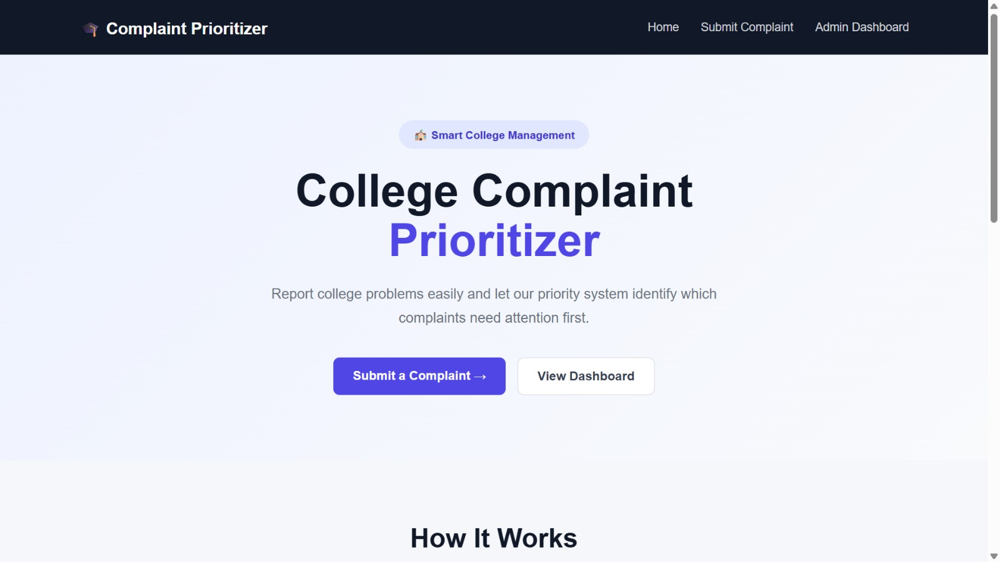
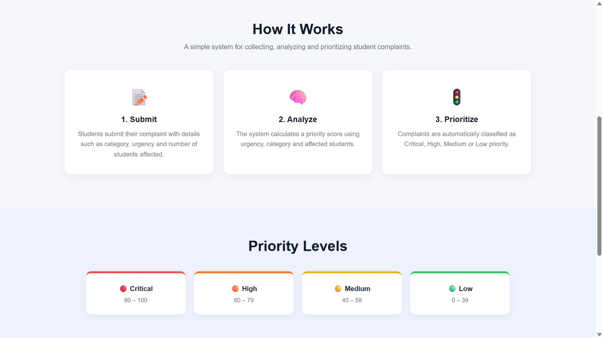
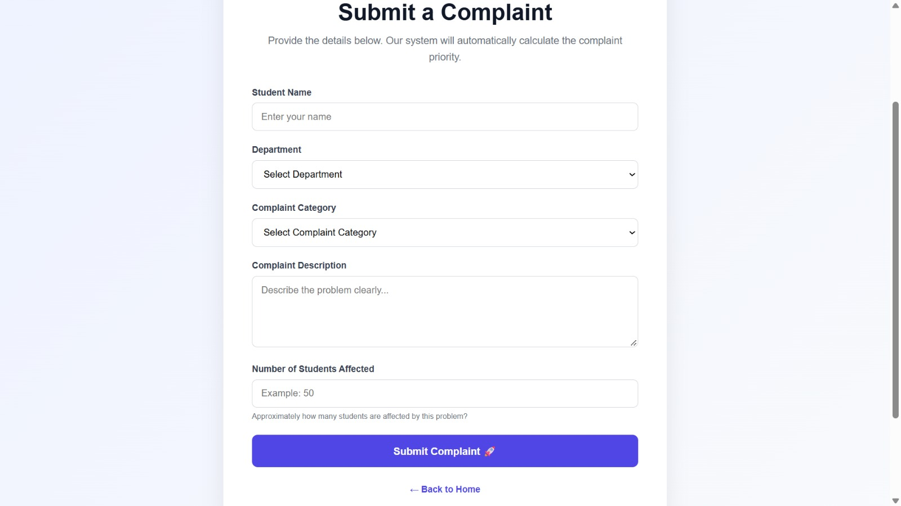
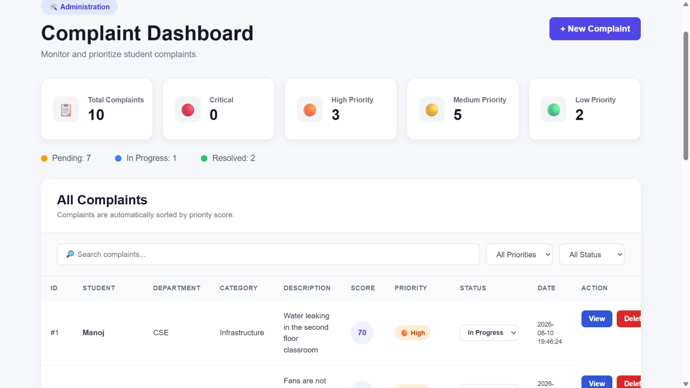

# College Complaint Prioritizer

A web-based application that helps colleges manage student complaints by assigning priority scores, categorizing issues, and tracking complaint resolution through an admin dashboard.

## Features

* **Student Complaint Submission:** Students can submit complaints related to college facilities, academics, safety, and IT infrastructure.
* **Automatic Priority Scoring:** Assigns priority scores to complaints based on their severity.
* **Priority Classification:** Categorizes complaints into Critical, High, Medium, and Low priorities.
* **Admin Dashboard:** Displays total complaints and complaint statistics.
* **Complaint Status Tracking:** Tracks complaints as Pending, In Progress, or Resolved.
* **Search and Filtering:** Helps administrators find complaints efficiently.
* **Complaint Management:** Administrators can view complaint details and manage complaint statuses.
* **Database Integration:** Stores complaint information for retrieval and management.

## Technologies Used

* **Backend:** Python, Flask
* **Frontend:** HTML, CSS, JavaScript
* **Database:** SQLite
* **Tools:** Visual Studio Code, Git, GitHub

## Project Structure

```text
College-Complaint-Prioritizer/
├── app.py
├── database.db
├── requirements.txt
├── README.md
├── templates/
│   ├── admin.html
│   ├── complaint.html
│   └── other HTML templates
└── static/
    ├── style.css
    └── script.js
```

## Installation and Setup

### 1. Clone the Repository

```bash
git clone https://github.com/24x55a0513-git/College-Complaint-Prioritizer.git
```

### 2. Navigate to the Project Folder

```bash
cd College-Complaint-Prioritizer
```

### 3. Create a Virtual Environment (Optional)

```bash
python -m venv venv
```

Activate it on Windows:

```bash
venv\Scripts\activate
```

### 4. Install Dependencies

```bash
pip install -r requirements.txt
```

### 5. Run the Application

```bash
python app.py
```

Open your browser and visit:

```text
http://127.0.0.1:5000
```

## How It Works

1. Students submit complaints through the web application.
2. The system evaluates complaint severity and assigns a priority score.
3. Complaints are categorized according to their priority.
4. Administrators view and manage complaints through the dashboard.
5. Complaint statuses are updated as issues progress toward resolution.

## Screenshots

### Home Page



### Admin Dashboard



### Complaint Details



### Complaint Management




## Project Objective

The objective of this project is to improve college complaint management by helping administrators identify urgent issues, organize student complaints, and track their resolution efficiently.

## Author

Developed as a college project to demonstrate web development, database integration, and complaint management.

## Repository

[College Complaint Prioritizer on GitHub](https://github.com/24x55a0513-git/College-Complaint-Prioritizer)

## Deployment
http://manoj513.pythonanywhere.com/